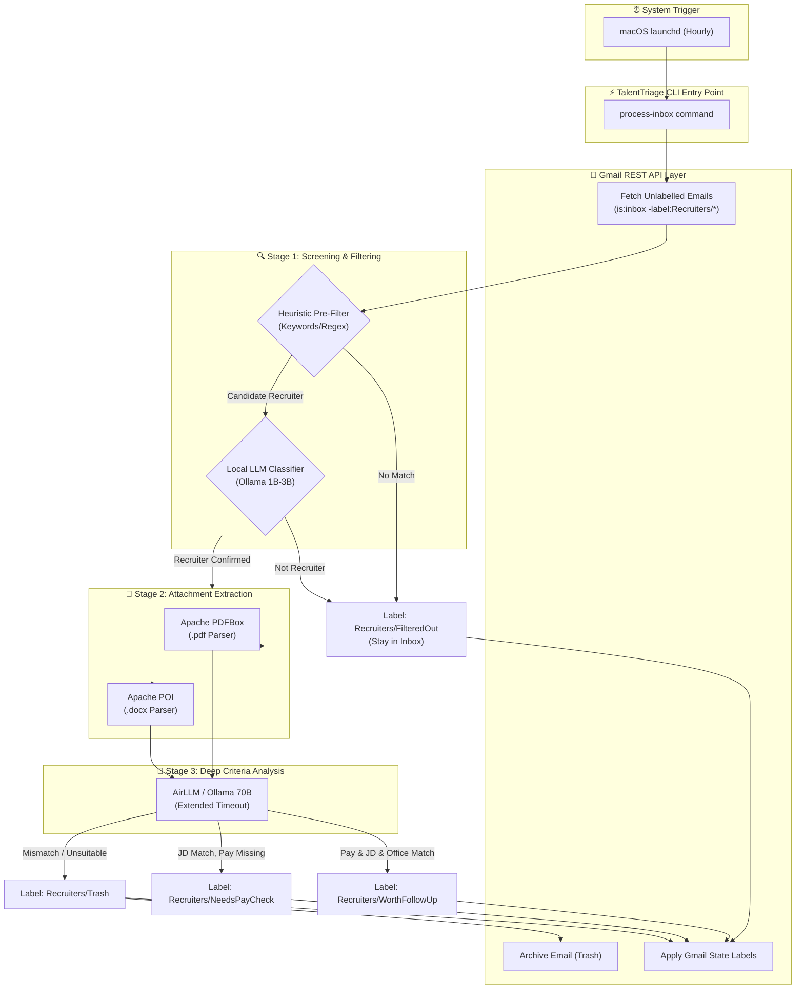

# TalentTriage 🎯

[](https://github.com/mlk/TalentTriage/actions/workflows/ci.yml)

> **A resource-efficient, local-first recruiter email triage engine built in Kotlin for macOS.**

**TalentTriage** automatically checks your Gmail inbox, filters out recruiter noise using local heuristic rules and lightweight LLM classification, extracts attached Job Descriptions (PDF/Word), and performs deep criteria analysis (Pay, JD relevance, Days in Office) using AirLLM or local Ollama instances.

---

## 🏗️ Architecture Overview

The system operates as an ephemeral, scheduled CLI job (`talent-triage process-inbox`) triggered by macOS `launchd`. It communicates with the Gmail REST API to track state using nested Gmail labels (`Recruiters/*`), avoiding background process memory overhead.



---

## ✨ Key Features

* **Zero-Idle Memory Footprint:** Executes completely as a CLI command and terminates, returning 100% of VRAM/RAM back to macOS.
* **Dual-Tier LLM Architecture:** Uses a fast, small model via Ollama for initial screening and routes qualified emails to an AirLLM Python wrapper (or large quantized Ollama model) for deep evaluation.
* **Stateless Gmail Tracking:** Uses nested Gmail labels (`Recruiters/FilteredOut`, `Recruiters/WorthFollowUp`, `Recruiters/NeedsPayCheck`, `Recruiters/Trash`) as state flags.
* **Document Parsing Engine:** Automatically extracts plain text/Markdown from attached `.pdf` and `.docx` job descriptions using Apache PDFBox and Apache POI. A broken attachment is reported, it never stops the run.
* **OpenAI/Ollama Compatibility:** Leverages native Ollama REST API JSON formats across all endpoints.
* **Dual-Tier LLM Architecture:** The same typed client talks to the local Ollama instance (short
  timeout) and to the AirLLM wrapper (long timeout) — only the base URL and the timeout differ.

---

## 🛠️ Tech Stack & Tooling

* **Language:** Kotlin (JVM 17)
* **Build System:** Gradle with **Kotlin DSL (`build.gradle.kts`)** and the Gradle Wrapper
* **Package Namespace:** `uk.me.michaellloydlee.recruiter`
* **HTTP Client:** Ktor Client CIO (`kotlinx.serialization`)
* **Attachment Parsers:** Apache PDFBox & Apache POI
* **Static Analysis & Linting:** `ktlint`, `detekt`
* **Code Coverage:** JaCoCo (**80% line coverage limit enforced**)
* **CI/CD:** GitHub Actions

---

## 🚀 Getting Started

### Prerequisites

* JDK 17+ (the Gradle daemon is pinned to JDK 17 via `gradle/gradle-daemon-jvm.properties`)
* [Ollama](https://ollama.ai/) installed and running locally on `http://localhost:11434` _(required from the Ollama client story onwards)_
* Python 3.10+ if using the optional AirLLM FastAPI wrapper on `http://localhost:8000` _(optional)_
* Google Cloud OAuth2 credentials (`credentials.json`) for Gmail REST API access — see [Gmail authentication](#-gmail-authentication)

### Installation & Build

1. **Clone the repository:**
   ```bash
   git clone https://github.com/mlk/TalentTriage.git
   cd TalentTriage
   ```

2. **Run the quality gates** (compiles, tests, lints, analyses and enforces the coverage limit):
   ```bash
   ./gradlew check
   ```

3. **Generate the coverage report** (HTML at `build/reports/jacoco/test/html/index.html`):
   ```bash
   ./gradlew jacocoTestReport
   ```

4. **Build the executable** (`build/install/recruiter-cli/bin/recruiter-cli`):
   ```bash
   ./gradlew installDist
   ```

---

## ⌨️ Command Line Interface

The executable is `recruiter-cli`. Every operation is a subcommand:

```bash
# build/install/recruiter-cli/bin/recruiter-cli process-inbox
# build/install/recruiter-cli/bin/recruiter-cli authenticate
# build/install/recruiter-cli/bin/recruiter-cli pending
```

`process-inbox` fetches the messages of the inbox that were not processed yet
and screens them: the ones that are not recruiter mails are filtered out with
the label `Recruiters/FilteredOut`, the recruiter mails are counted for the
deep evaluation that comes with its own story.

The requirements of the job seeker — the pay, the profile and the number of
days of office a job may demand — are read from `requirements.json` in the
working directory (`--requirements` changes the file):

```json
{
  "minimum_pay": { "amount": 120000, "currency": "EUR", "period": "year" },
  "maximum_office_days": 2,
  "profile": "Senior Kotlin engineer, distributed systems, 8+ years, fintech"
}
```

The screening asks a model of the local Ollama instance. By default it is a
**decision model** (`clef:cloud`), which answers a typed question on the
decision API of Ollama: `from a recruiter`, `not from a recruiter` or
`unknown`, with the probability of every answer. A chat model can be used
instead:

```bash
# the screening of the recruiter mails
recruiter-cli process-inbox                                  # the decision model (default)
recruiter-cli process-inbox --recruiter-verification=llm     # a chat model
recruiter-cli process-inbox --recruiter-verification-model=nimble

# the evaluation of the job descriptions
recruiter-cli process-inbox --job-description-evaluation=decision   # the decision model (default)
recruiter-cli process-inbox --job-description-evaluation=chat      # a chat model
recruiter-cli process-inbox --job-description-evaluation-model=clef:cloud
```

Every step of the pipeline gets its own model, so the model of the recruiter
verification is chosen with `--recruiter-verification-model` and the model of
the job description evaluation with `--job-description-evaluation-model`.

The default models of both verifiers run in the cloud of Ollama (`clef:cloud`
and `minimax-m3.1-flash:cloud`), they need a paid plan or usage credits. A
local model works as well: `nimble`, `tev1`, `clef` and `clef-flash` are the
decision models, they need Ollama v0.35.0 or later.

### The arguments of the commands

| Command | Argument | What it does | Default |
| --- | --- | --- | --- |
| `authenticate` | `--credentials`, `-c` | The file with the OAuth2 client credentials | `credentials.json` |
| `authenticate` | `--token`, `-t` | The file the OAuth2 token is stored in | `token.json` |
| `pending` | `--credentials`, `-c` | The file with the OAuth2 client credentials | `credentials.json` |
| `pending` | `--token`, `-t` | The file the OAuth2 token is stored in | `token.json` |
| `pending` | `--since` | How far back the messages are looked for, an ISO-8601 duration | `PT24H` |
| `pending` | `--limit`, `-l` | The number of messages that are shown | `20` |
| `process-inbox` | `--credentials`, `-c` | The file with the OAuth2 client credentials | `credentials.json` |
| `process-inbox` | `--token`, `-t` | The file the OAuth2 token is stored in | `token.json` |
| `process-inbox` | `--requirements`, `-q` | The file with the requirements of the job seeker | `requirements.json` |
| `process-inbox` | `--recruiter-verification` | How the recruiter mails are verified: a decision model or a chat model | `decision` |
| `process-inbox` | `--recruiter-verification-model`, `-m` | The model that verifies the recruiter mails | `clef:cloud` |
| `process-inbox` | `--recruiter-verification-endpoint` | The endpoint of the model that verifies the recruiter mails | `http://localhost:11434` |
| `process-inbox` | `--recruiter-verification-timeout` | How long the verification of a recruiter mail may take, in milliseconds | `120000` |
| `process-inbox` | `--job-description-evaluation` | How the job descriptions are evaluated: a decision model or a chat model | `decision` |
| `process-inbox` | `--job-description-evaluation-model`, `-j` | The model that evaluates the job descriptions | `clef:cloud` |
| `process-inbox` | `--job-description-evaluation-endpoint` | The endpoint of the model that evaluates the job descriptions | `http://localhost:11434` |
| `process-inbox` | `--job-description-evaluation-timeout` | How long the evaluation of a job description may take, in milliseconds | `600000` |

The models with the suffix `:cloud` run in the cloud of Ollama and need a paid plan or usage
credits. The local decision models are `nimble`, `tev1`, `clef` and `clef-flash`, they need
Ollama v0.35.0 or later.


or, without installing the distribution:

```bash
./gradlew run --args="process-inbox"
```

`process-inbox` runs one inbox triage pass and writes **structured** log output — one JSON
object per line — to standard output:

```json
{"timestamp":"2026-10-24T07:57:23.916683Z","level":"INFO","event":"process-inbox.started","message":"Inbox triage run started","attributes":{"trigger":"cli"}}
{"timestamp":"2026-10-24T07:57:23.926923Z","level":"INFO","event":"process-inbox.completed","message":"Inbox triage run completed"}
```

The command exits with status code `0` when the run succeeded and `1` when the command line
could not be parsed. The pipeline stages behind the run (fetching the mail, screening it,
extracting the attachments, evaluating them) are delivered by their own stories.

> **Note:** on JDK 24 and newer, Clikt's terminal detection prints a `native-access` warning
> to standard error. Standard output stays clean JSON; add `--enable-native-access=ALL-UNNAMED`
> to the JVM arguments to silence it.

---

## 📬 The state of the mailbox

Gmail is the state store of the pipeline. Every processed message carries one
of the nested state labels, so the search `is:inbox -label:Recruiters/*` matches
exactly the messages that were not processed yet:

| Label | Meaning | Archived |
| --- | --- | --- |
| `Recruiters/FilteredOut` | not a recruiter mail | no, it stays in the inbox |
| `Recruiters/WorthFollowUp` | worth a follow up | no, it stays in the inbox |
| `Recruiters/NeedsPayCheck` | a recruiter mail, but the pay has to be checked | no, it stays in the inbox |
| `Recruiters/Trash` | not worth any attention | yes, the message leaves the inbox |

A message carries exactly one state label - applying a new state removes the
other ones - and the state labels are created in the mailbox when they do not
exist yet. The state label is the marker of the pipeline: the search of the
pending mails (`is:inbox -label:Recruiters/*`) skips every message that
carries one, so a message that was processed is never looked at again.

The pipeline is a scheduled job, so it only processes the mail that arrived
since the last run: the search is `is:inbox -label:Recruiters/* after:<time>`,
the window is 24 hours by default.

`recruiter-cli pending` lists the messages that were not processed yet, it is
the quickest way to check that the credentials work. The pipeline only looks at
the mail that arrived recently — the last 24 hours by default, `--since P7D`
looks a week back:

```bash
recruiter-cli pending            # the last 24 hours
recruiter-cli pending --since P7D  # the last seven days
```

```json
{"timestamp":"…","level":"INFO","event":"pending.listed","message":"The inbox messages that were not processed yet","attributes":{"count":"2"}}
{"timestamp":"…","level":"INFO","event":"pending.message","message":"A message of the inbox that was not processed yet","attributes":{"id":"…","sender":"…","subject":"…"}}
```

---

## 🔐 Gmail authentication

The Gmail REST API needs an OAuth2 token. The token is obtained once and refreshed
automatically afterwards.

1. **Create a Google Cloud project** and enable the Gmail API, then create an *OAuth client
   ID* of the type *Desktop app*. Download the credentials and save them as
   `credentials.json` in the working directory:

   ```json
   {
     "installed": {
       "client_id": "…apps.googleusercontent.com",
       "client_secret": "…",
       "auth_uri": "https://accounts.google.com/o/oauth2/auth",
       "token_uri": "https://oauth2.googleapis.com/token",
       "redirect_uris": ["http://localhost"]
     }
   }
   ```

   Both the `installed`/`web` format of Google and the flat format above are accepted.

2. **Authorise the application:**

   ```bash
   recruiter-cli authenticate
   ```

   The command prints the URL of the Google authorisation page. Open it in a browser, allow
   the application to access the mailbox and copy the authorisation code from the address bar
   of the redirect. The redirect itself fails to connect — that is expected, the code in the
   address bar is what matters.

3. **Exchange the code for a token:**

   ```bash
   recruiter-cli authenticate <code>
   ```

   The token is written to `token.json` (both files are git-ignored) and the access token is
   refreshed automatically when it expires.

---

## 🧪 Quality Standards & Testing

This repository enforces strict code quality gates via Gradle tasks:

| Command | Purpose |
| --- | --- |
| `./gradlew test` | Runs the JUnit 5 test suite |
| `./gradlew ktlintCheck` | Verifies formatting/lint rules (`ktlint_official` code style) |
| `./gradlew ktlintFormat` | Auto-formats the sources |
| `./gradlew detekt` | Runs static analysis (zero warnings allowed) |
| `./gradlew jacocoTestReport` | Writes the JaCoCo HTML/XML report and **fails the build** below 80% line coverage |
| `./gradlew check` | Runs all of the above as a single gate |
| `./gradlew installDist` | Builds the `recruiter-cli` executable in `build/install/recruiter-cli/bin` |

Configuration lives in:

* `gradle/libs.versions.toml` — version catalog (all dependency/plugin versions)
* `config/detekt/detekt.yml` — detekt rule configuration
* `.editorconfig` — ktlint/IDE formatting rules

The conventions of the repository (architecture, the rules for interfaces and
error handling, the testing conventions) are documented in
[`AGENTS.md`](AGENTS.md).

---

## 📁 Project Layout

```
src/main/kotlin/uk/me/michaellloydlee/recruiter/
├── application/       # Use cases / orchestration
│   └── screening/     # The heuristic pre-filter and the local classifier
│                      # (the pipeline of the process-inbox command)
├── cli/               # Command line entry point (Clikt commands)
├── domain/            # Pure domain model, no infrastructure dependencies
│   ├── gmail/         # The state labels of the pipeline
│   └── screening/     # The rules of the screening
└── infrastructure/    # Gmail, Ollama, PDF/Word adapters, logging
    ├── gmail/         # OAuth2 credentials, token store, Gmail REST client, label state
    ├── llm/           # Ollama chat client (local models and the AirLLM wrapper)
    ├── logging/       # Structured (JSON lines) logger
    ├── parser/        # Text extraction of the attached documents (PDFBox)
    └── serialization/ # Shared kotlinx.serialization helpers
```

> **Note:** the package namespace drops the hyphens of the `uk.me.michael-lloyd-lee` domain because hyphens are not legal in Kotlin package names.

---

## 📄 License

Distributed under the MIT License. See `LICENSE` for more information.
