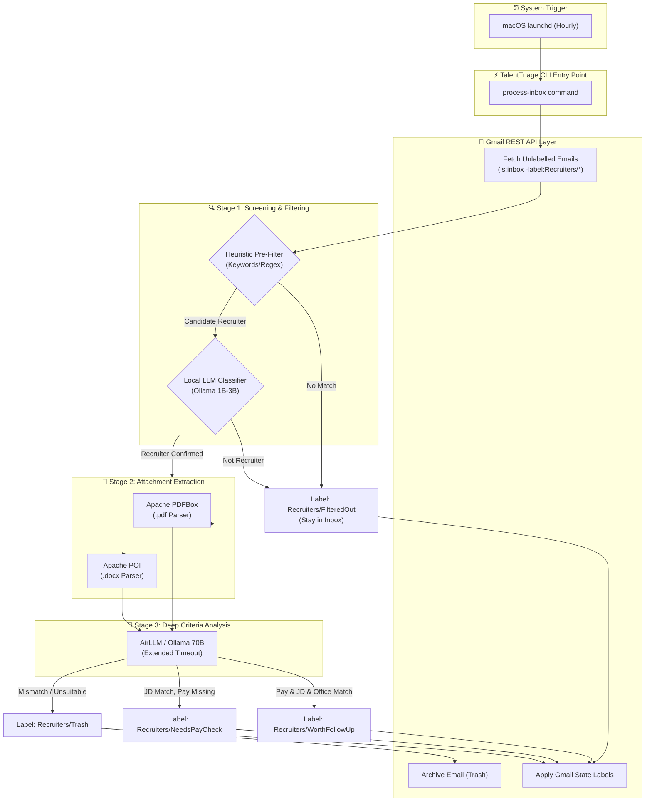

# TalentTriage 🎯

> **A resource-efficient, local-first recruiter email triage engine built in Kotlin for macOS.**

**TalentTriage** automatically checks your Gmail inbox, filters out recruiter noise using local heuristic rules and lightweight LLM classification, extracts attached Job Descriptions (PDF/Word), and performs deep criteria analysis (Pay, JD relevance, Days in Office) using AirLLM or local Ollama instances.

---

## 🏗️ Architecture Overview

The system operates as an ephemeral, scheduled CLI job (`talent-triage process-inbox`) triggered by macOS `launchd`. It communicates with the Gmail REST API to track state using nested Gmail labels (`Recruiters/*`), avoiding background process memory overhead.



---

## ✨ Key Features

* **Zero-Idle Memory Footprint:** Executes completely as a CLI command and terminates, returning 100% of VRAM/RAM back to macOS.
* **Dual-Tier LLM Architecture:** Uses a fast, small model via Ollama for initial screening and routes qualified emails to an AirLLM Python wrapper (or large quantized Ollama model) for deep evaluation.
* **Stateless Gmail Tracking:** Uses nested Gmail labels (`Recruiters/FilteredOut`, `Recruiters/WorthFollowUp`, `Recruiters/NeedsPayCheck`, `Recruiters/Trash`) as state flags.
* **Document Parsing Engine:** Automatically extracts plain text/Markdown from attached `.pdf` and `.docx` job descriptions using Apache PDFBox and Apache POI.
* **OpenAI/Ollama Compatibility:** Leverages native Ollama REST API JSON formats across all endpoints.

---

## 🛠️ Tech Stack & Tooling

* **Language:** Kotlin (JVM 17)
* **Build System:** Gradle with **Kotlin DSL (`build.gradle.kts`)** and the Gradle Wrapper
* **Package Namespace:** `uk.me.michaellloydlee.recruiter`
* **HTTP Client:** Ktor Client CIO (`kotlinx.serialization`)
* **Attachment Parsers:** Apache PDFBox & Apache POI
* **Static Analysis & Linting:** `ktlint`, `detekt`
* **Code Coverage:** JaCoCo (**80% line coverage limit enforced**)
* **CI/CD:** GitHub Actions

---

## 🚀 Getting Started

### Prerequisites

* JDK 17+ (the Gradle daemon is pinned to JDK 17 via `gradle/gradle-daemon-jvm.properties`)
* [Ollama](https://ollama.ai/) installed and running locally on `http://localhost:11434` _(required from the Ollama client story onwards)_
* Python 3.10+ if using the optional AirLLM FastAPI wrapper on `http://localhost:8000` _(optional)_
* Google Cloud OAuth2 credentials (`credentials.json`) for Gmail REST API access _(required from the Gmail story onwards)_

### Installation & Build

1. **Clone the repository:**
   ```bash
   git clone https://github.com/mlk/TalentTriage.git
   cd TalentTriage
   ```

2. **Run the quality gates** (compiles, tests, lints, analyses and enforces the coverage limit):
   ```bash
   ./gradlew check
   ```

3. **Generate the coverage report** (HTML at `build/reports/jacoco/test/html/index.html`):
   ```bash
   ./gradlew jacocoTestReport
   ```

---

## 🧪 Quality Standards & Testing

This repository enforces strict code quality gates via Gradle tasks:

| Command | Purpose |
| --- | --- |
| `./gradlew test` | Runs the JUnit 5 test suite |
| `./gradlew ktlintCheck` | Verifies formatting/lint rules (`ktlint_official` code style) |
| `./gradlew ktlintFormat` | Auto-formats the sources |
| `./gradlew detekt` | Runs static analysis (zero warnings allowed) |
| `./gradlew jacocoTestReport` | Writes the JaCoCo HTML/XML report and **fails the build** below 80% line coverage |
| `./gradlew check` | Runs all of the above as a single gate |

Configuration lives in:

* `gradle/libs.versions.toml` — version catalog (all dependency/plugin versions)
* `config/detekt/detekt.yml` — detekt rule configuration
* `.editorconfig` — ktlint/IDE formatting rules

---

## 📁 Project Layout

```
src/main/kotlin/uk/me/michaellloydlee/recruiter/
├── application/   # Use cases / orchestration
├── cli/           # Command line entry point
├── domain/        # Pure domain model, no infrastructure dependencies
└── infrastructure/# Gmail, Ollama, PDF/Word adapters
```

> **Note:** the package namespace drops the hyphens of the `uk.me.michael-lloyd-lee` domain because hyphens are not legal in Kotlin package names.

---

## 📄 License

Distributed under the MIT License. See `LICENSE` for more information.
